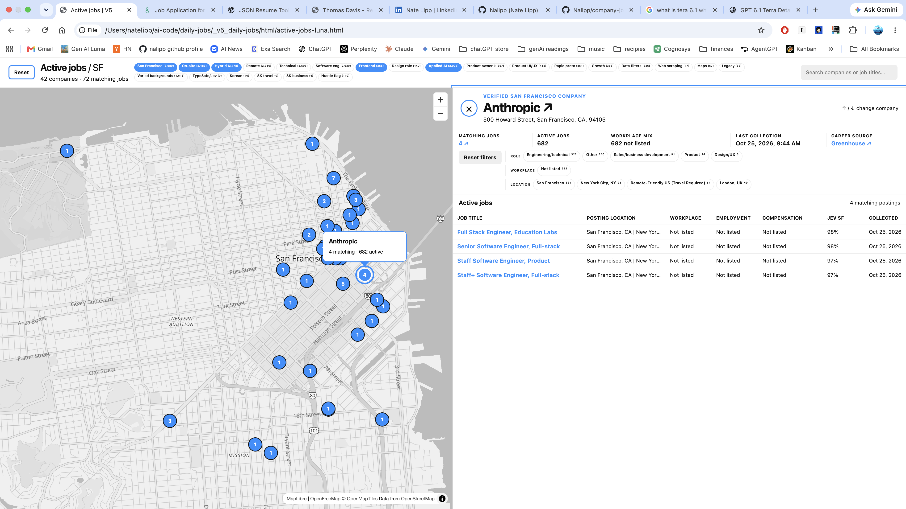

# Company jobs

Company jobs is a project to collect every open job in San Francisco directly from company careers pages and official job feeds. Natural-language rules in your constraints file then filter those postings into a shortlist of the jobs that fit you.



*A saved search narrowed the results to 42 companies and 72 matching jobs. Selecting a company shows its sources and matching roles.*

## Technologies

**Python · JavaScript · SQLite · LLMs · JEV · HTML/CSS**

`Web scrape → SQLite → LLM research → JEV scoring → JSON → HTML`

## From a city of companies to your shortlist

The goal is city-wide coverage: build a company catalog, find each company's official job sources, and collect its open roles before filtering.

1. **Find and verify companies.** Combine company directories and supplied lists. LLM research checks physical San Francisco offices, map coordinates, and official career pages, keeping evidence for each decision.
2. **Collect from the source.** Read Ashby, Greenhouse, and Lever feeds directly; use browser research for other sites. Follow pagination and save full posting text, original links, and job details in SQLite.
3. **Track what was covered.** Shared queues let workers research in parallel. Stable IDs prevent duplicates. Complete scans can mark vanished jobs inactive; partial scans preserve earlier jobs until coverage is complete.
4. **Apply personal rules.** Saved constraints guide the LLM workflows. JEV scores questions about role, location, work style, and interests. Cached scores and chosen thresholds produce a shortlist, JSON results, and an HTML map with links to apply.

## How it grew

- **[v1](_v1_daily-jobs/):** Started with JSON search profiles, a company catalog, and repeatable job checks.
- **[v2](_v2_daily-jobs/):** Added AI research, with Python validating updates before saving them.
- **[v3](_v3_daily-jobs/):** Separated company facts, career sources, and search profiles for reuse.
- **[v4](_v4_daily-jobs/):** Scaled research with parallel workers, shared queues, and an HTML browser.
- **[v5](_v5_daily-jobs/):** Moved postings into SQLite, then added cached JEV scores and map filters.

## Run locally

Requires **Python 3.11+**. The data tools run on macOS or Linux.

### Preview the saved results

```bash
git clone https://github.com/Nalipp/company-jobs.git
cd company-jobs
python3 -m http.server 8000
```

Open the [jobs browser](http://localhost:8000/_v5_daily-jobs/html/active-jobs-luna.html). This saved snapshot needs no API key; map tiles need internet access.

### Collect fresh jobs

In another terminal, start from the repository root. Recreate the local lock files, import the saved company research, and collect a batch of official job feeds:

```bash
touch _v4_daily-jobs/data/companies.lock _v4_daily-jobs/data/queues/company-queue.lock
cd _v5_daily-jobs
python3 scripts/v5-data import-v4 --v4-root ../_v4_daily-jobs --database data/v5.sqlite
python3 scripts/collect-jobs run-structured --limit 25
```

Repeat the last command until no structured sources are due. For sites that need browser research, open `_v5_daily-jobs` in Codex and run `$collect-jobs --run luna`.

### Match and display

Earlier versions use saved [JSON constraints](_v4_daily-jobs/data/profiles/ai-product-frontend-v1.json). In v5, change `ACTIVE_FILTERS` in [explore_jobs.py](jev/explore_jobs.py), or pass `--filter FEATURE=THRESHOLD`. JEV scores each rule and caches the answers, so changing a threshold reuses earlier work.

From the repository root, provide a TypeSafe API key, score 100 collected jobs, and rebuild the browser:

```bash
export TYPESAFE_API_KEY="your-key"
python3 jev/explore_jobs.py --limit 100 --evaluate-all --output jev/matches.json
python3 _v5_daily-jobs/scripts/build_active_jobs_html_luna.py
```

Replace `--limit 100` with `--all` to score every active posting. Refresh the browser to see the new results. Databases and API keys stay local.
