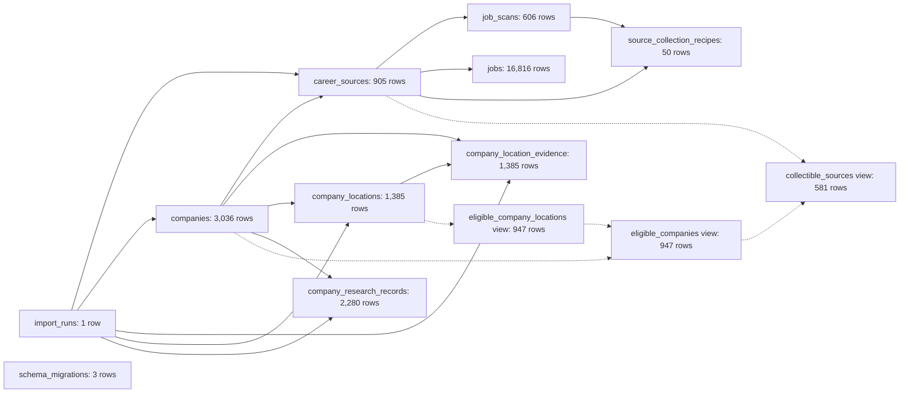

# V5 SQLite data counts map

Generated from `data/v5.sqlite` at `2026-09-20T16:22:52+00:00`.
Each node shows the current row count. Views are included so the map distinguishes stored data from derived eligibility data.

## Counts

- `career_sources`: **905** rows
- `companies`: **3,036** rows
- `company_location_evidence`: **1,385** rows
- `company_locations`: **1,385** rows
- `company_research_records`: **2,280** rows
- `import_runs`: **1** rows
- `job_scans`: **606** rows
- `jobs`: **16,816** rows
- `schema_migrations`: **3** rows
- `source_collection_recipes`: **50** rows
- `collectible_sources` (view): **581** rows
- `eligible_companies` (view): **947** rows
- `eligible_company_locations` (view): **947** rows
