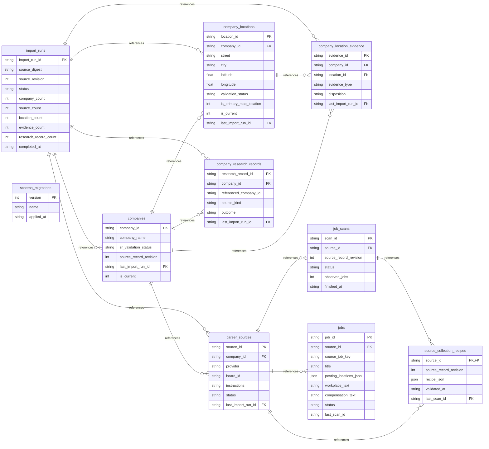

# V5 SQLite table and relationship map

Generated from `data/v5.sqlite` at `2026-09-20T16:22:52+00:00`.
This diagram includes physical SQLite tables only. The eligibility views are documented in the counts map.

